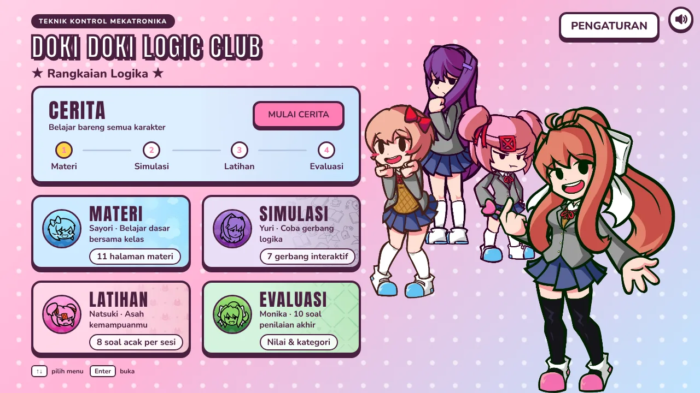
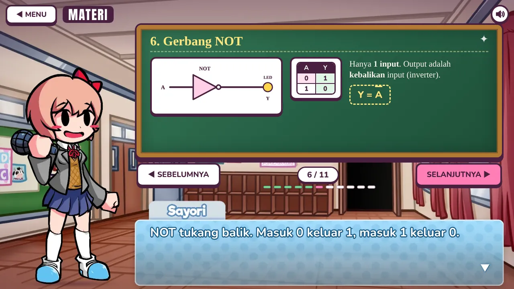
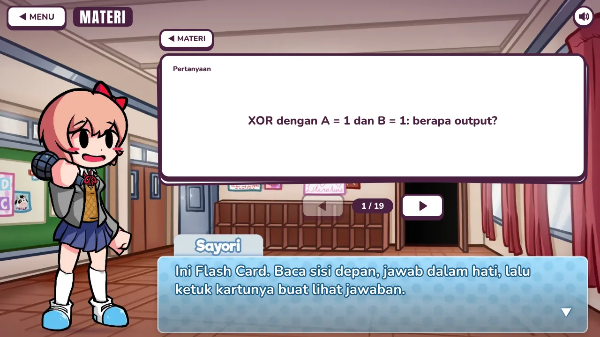
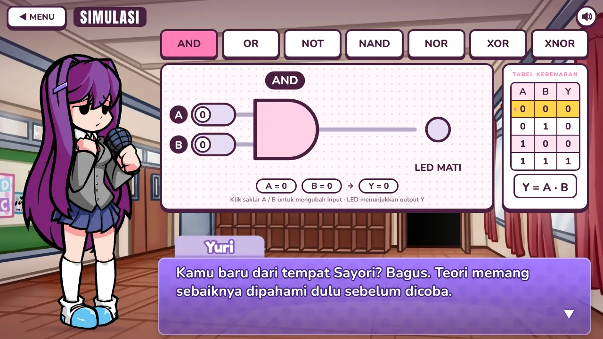
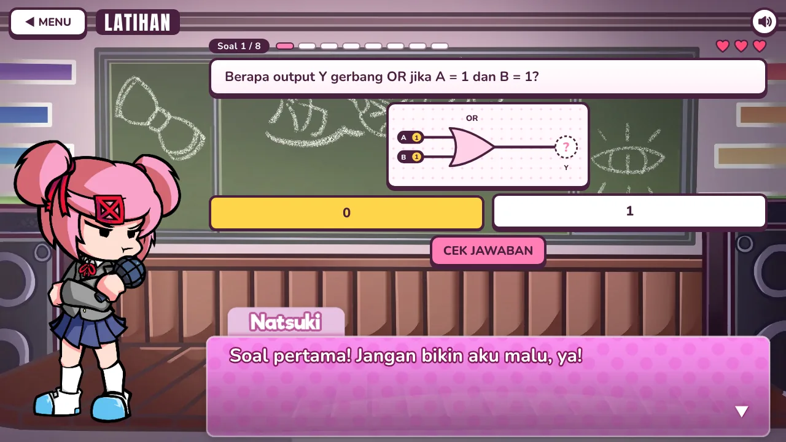
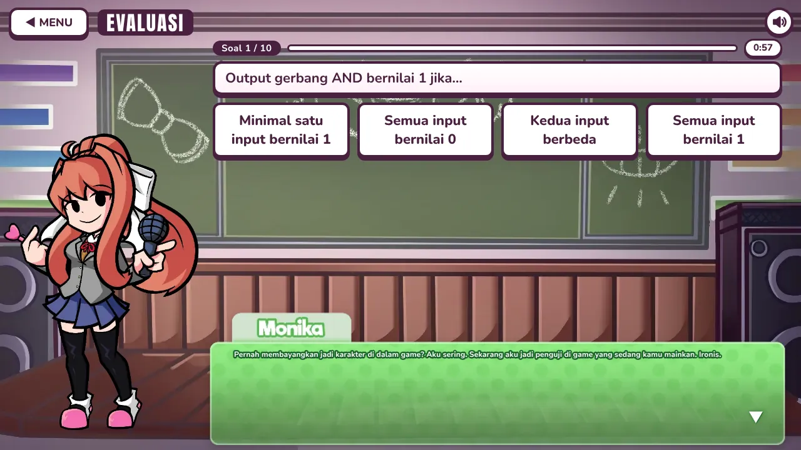

# Doki Doki Logic Club

Visual novel berbasis web untuk belajar rangkaian logika di mata pelajaran Teknik Kontrol Mekatronika (TKM). Pemain belajar gerbang logika bersama Sayori, Yuri, Natsuki, dan Monika dari *Doki Doki Literature Club*: membaca materi, mencoba gerbang, berlatih, lalu mengerjakan evaluasi.

Proyek ini dibuat dengan HTML, CSS, dan JavaScript biasa. Tidak ada framework, dependensi, maupun langkah build.



## Daftar isi

- [Fitur](#fitur)
- [Tampilan](#tampilan)
- [Menjalankan](#menjalankan)
- [Struktur proyek](#struktur-proyek)
- [Mengubah isi pelajaran](#mengubah-isi-pelajaran)
- [Data yang disimpan](#data-yang-disimpan)
- [Atribusi dan hak cipta](#atribusi-dan-hak-cipta)

## Fitur

Menu utama punya lima pilihan. Tiap bagian dipandu satu karakter yang bereaksi terhadap jawaban dan perpindahan antarbagian.

| Bagian | Pemandu | Isi |
|---|---|---|
| Cerita | Keempat karakter | Alur dari materi sampai evaluasi. Beberapa adegan memberi pilihan jawaban. Kemajuan tersimpan dan bisa dilanjutkan atau diulang. |
| Materi | Sayori | 11 halaman: pengertian rangkaian logika, input dan output, logika 0 dan 1, gerbang AND, OR, NOT, NAND, NOR, XOR, XNOR, dan tabel kebenaran. Setelah halaman terakhir ada **Flash Card**. |
| Simulasi | Yuri | **Simulasi Dasar** untuk 7 gerbang dengan saklar input, LED output, dan tabel kebenaran. **Simulasi+** untuk menyusun rangkaian sendiri. |
| Latihan | Natsuki | 8 soal acak per sesi dengan 3 nyawa dan skor terbaik. |
| Evaluasi | Monika | 10 soal acak dari bank 19 soal, 60 detik per soal, dengan empat kategori nilai dari "Perlu Belajar Lagi" sampai "Sangat Baik". |

### Flash Card

19 kartu tanya-jawab yang diacak setiap kali dibuka. Ketuk kartu untuk membalik, gunakan tombol panah (atau tombol panah kiri dan kanan di keyboard) untuk pindah kartu. Tidak ada penilaian dan tidak ada yang disimpan.

### Simulasi+

- Seret kartu input dan gerbang ke kanvas, lalu tarik kabel di antaranya.
- Tabel kebenaran rangkaian dihitung otomatis.
- Mode Langkah menelusuri rangkaian dari input ke output, satu gerbang per langkah.
- 8 tantangan, misalnya membuat NOT atau XOR hanya dari gerbang NAND.
- Undo dan redo dengan `Ctrl+Z` dan `Ctrl+Shift+Z` (atau `Ctrl+Y`). Di macOS pakai `Cmd`.

### Latihan

Jenis soal: output gerbang, tabel kebenaran, mengenali gerbang, membaca rangkaian, persamaan Boolean, menebak gerbang dari tabel, mencocokkan simbol dengan nama, dan menyalakan LED lewat saklar. Setiap jawaban salah mengurangi satu nyawa. Latihan berhenti saat nyawa habis atau setelah 8 soal selesai.

### Mode Cerita

Tombol lanjut baru muncul setelah halaman materi terakhir dibaca, syarat Simulasi terpenuhi, dan Latihan serta Evaluasi selesai. Keempat bagian lain bisa dibuka kapan saja dari menu.

### Pengaturan

- Volume musik dan volume efek suara punya slider sendiri.
- Mode tampilan: jendela atau layar penuh (layar penuh tidak tersedia di Safari iPhone dan iPad).
- Tata letak: otomatis, desktop, atau mobile. Mode mobile mendukung potret dan lanskap. Mode otomatis memilih mobile pada layar sentuh kecil dan pada jendela yang lebih sempit dari 768 px.
- Semua pengaturan tersimpan di browser.

## Tampilan

| | |
|---|---|
|  |  |
| Materi | Flash Card |
|  |  |
| Simulasi | Latihan |



## Menjalankan

Game ini statis, jadi cukup disajikan lewat server HTTP apa pun.

**Di komputer sendiri.** Jalankan dari folder proyek:

```
python -m http.server 8000
```

Lalu buka `http://localhost:8000`. Jangan membuka `index.html` dengan klik ganda: browser memblokir pemuatan berkas lokal yang dipakai game.

**Lewat GitHub Pages.** Buka *Settings > Pages*, pilih branch yang ingin dipublikasikan dengan folder root.

Setelah dimuat sekali, game tetap bisa dibuka tanpa internet berkat service worker (`sw.js`). Kode game selalu diambil dari jaringan lebih dulu agar pembaruan terbaca, sedangkan gambar, musik, dan font disimpan di cache. Service worker hanya aktif di `localhost` atau HTTPS.

Browser yang dipakai sebaiknya versi terbaru. Beberapa bagian tampilan memakai `:has()` dan container query.

## Struktur proyek

```
index.html            kerangka halaman
sw.js                 service worker untuk cache offline
css/style.css         seluruh tampilan, termasuk tata letak mobile (kelas .m dan .p)
js/core.js            utilitas, atlas karakter, audio, mesin dialog, gambar gerbang logika
js/content.js         materi, Flash Card, bank soal Latihan dan Evaluasi, kategori nilai, data credit
js/dialogue.js        dialog tiap karakter menurut kepribadiannya
js/story.js           naskah dan alur Mode Cerita
js/settings.js        pengaturan tersimpan dan penyesuaian layout
js/simplus.js         pemilih mode Simulasi dan Simulasi+
js/app.js             menu, navigasi, Materi, Simulasi Dasar, Latihan, Evaluasi
assets/               gambar, audio, font, dan konfigurasi karakter
CREDITS.md            daftar atribusi aset
```

## Mengubah isi pelajaran

| Yang diubah | Berkas |
|---|---|
| Halaman materi, kartu Flash Card, bank soal, kategori nilai | `js/content.js` |
| Gaya bicara karakter | `js/dialogue.js` |
| Naskah dan pilihan di Mode Cerita | `js/story.js` |
| Tantangan Simulasi+ | `js/simplus.js` (konstanta `CH`) |
| Jumlah dan durasi soal Evaluasi | `EVAL_N` di `js/content.js`, `EVAL_TIME` di `js/app.js` |

Menambah kartu Flash Card cukup dengan menambah satu objek ke daftar `FLASH`.

## Data yang disimpan

Semuanya disimpan di `localStorage` browser pemain. Tidak ada data yang dikirim ke server.

| Kunci | Isi |
|---|---|
| `tkm_settings` | Volume, mode tampilan, tata letak |
| `tkm_story` | Kemajuan Mode Cerita |
| `tkm_latihan_best` | Skor terbaik Latihan |
| `tkm_eval_best` | Jumlah benar terbaik di Evaluasi (0 sampai 10) |

## Atribusi dan hak cipta

Proyek ini non-komersial dan dibuat untuk keperluan belajar. Karakter, grafis, musik, dan efek suara berasal dari proyek lain. Hak atas semuanya tetap milik pembuat aslinya.

- **Doki Doki Literature Club** dibuat oleh Dan Salvato dan Team Salvato. Karakter Sayori, Yuri, Natsuki, dan Monika milik mereka. Proyek ini mengikuti [IP Guidelines Team Salvato](https://teamsalvato.com/ip-guidelines): gratis dan non-komersial. Karya aslinya bisa didukung di [teamsalvato.com](https://teamsalvato.com).
- **Doki Doki Takeover** dibuat oleh Jorge-SunSpirit dan kontributornya. Sprite, potret, latar, musik, dan efek suara berasal dari [repositori Doki Doki Takeover](https://github.com/Jorge-SunSpirit/Doki-Doki-Takeover) yang berlisensi Apache 2.0. Teks lisensinya ada di [`LICENSE-DokiDokiTakeover.txt`](LICENSE-DokiDokiTakeover.txt).
- Font Anton dan Nunito memakai SIL Open Font License 1.1. Teks lisensinya ada di folder `assets/fonts`.

Rincian aset per folder ada di [`CREDITS.md`](CREDITS.md). Daftar kredit juga tampil di dalam game, lewat Pengaturan > Credit.
