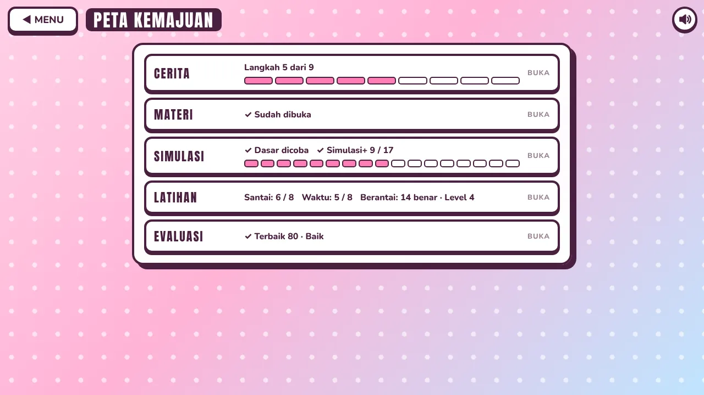
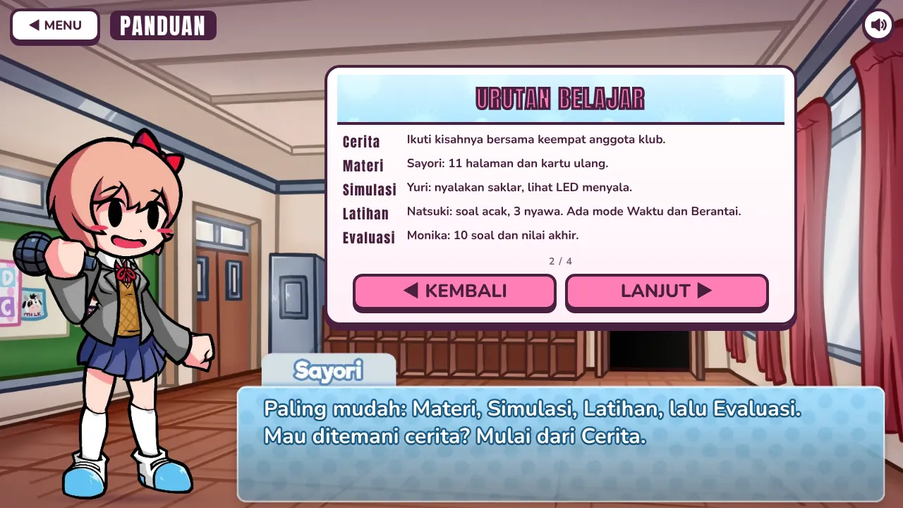
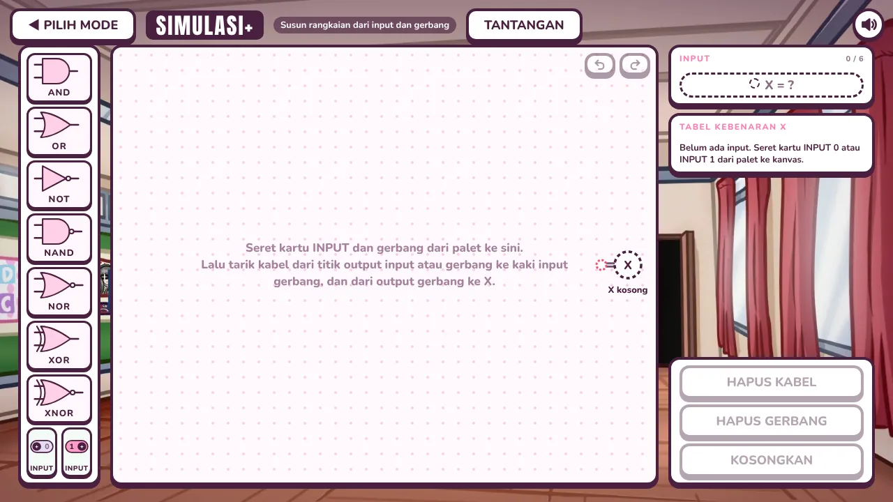
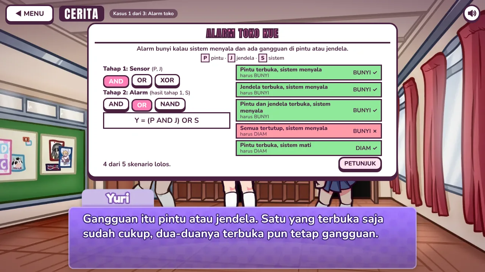
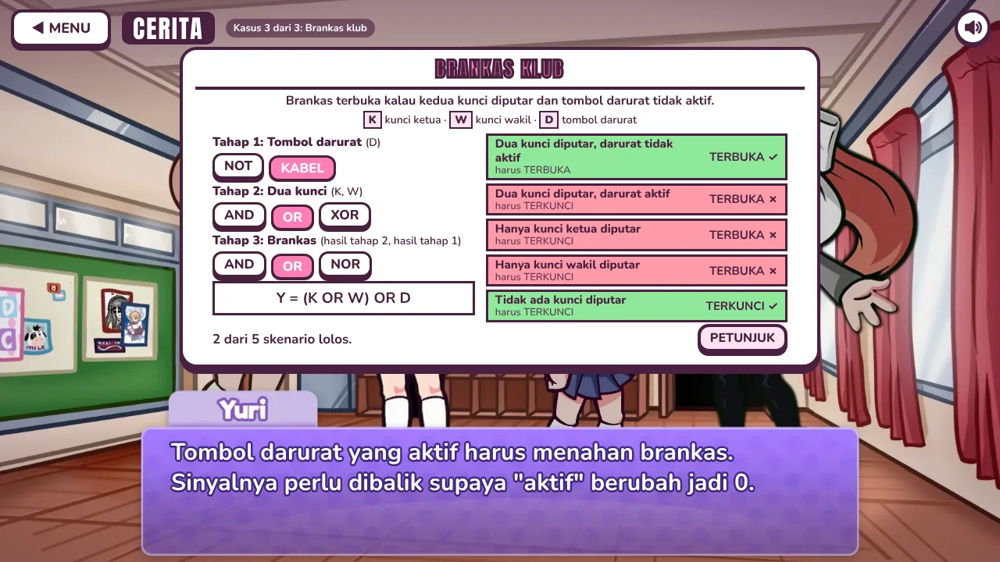
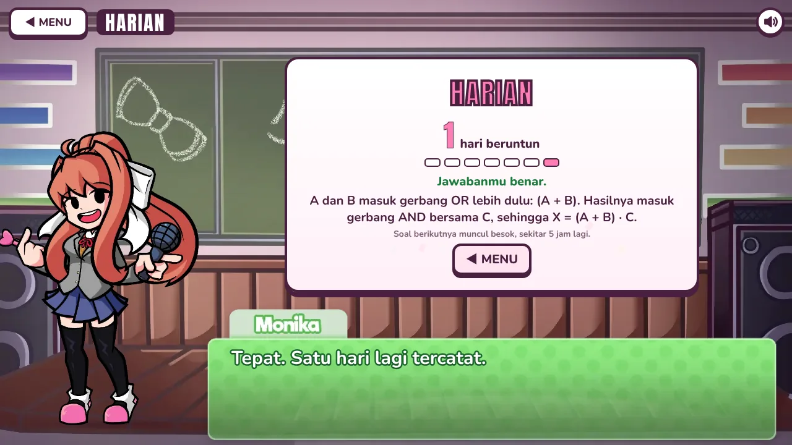
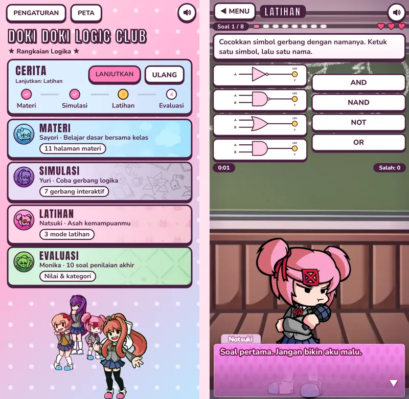

# Doki Doki Logic Club

Visual novel berbasis web untuk belajar rangkaian logika di mata pelajaran Teknik Kontrol Mekatronika (TKM). Pemain belajar gerbang logika bersama Sayori, Yuri, Natsuki, dan Monika dari *Doki Doki Literature Club*: membaca materi, mencoba gerbang, berlatih, lalu mengerjakan evaluasi.

Proyek ini dibuat dengan HTML, CSS, dan JavaScript biasa. Tidak ada framework, dependensi, maupun langkah build. Game bisa dimainkan di komputer dan HP, dan bisa dipasang ke layar utama seperti aplikasi.


## Daftar isi

- [Fitur](#fitur)
- [Tampilan](#tampilan)
- [Pasang sebagai aplikasi](#pasang-sebagai-aplikasi)
- [Menjalankan](#menjalankan)
- [Struktur proyek](#struktur-proyek)
- [Mengubah isi pelajaran](#mengubah-isi-pelajaran)
- [Data yang disimpan](#data-yang-disimpan)
- [Atribusi dan hak cipta](#atribusi-dan-hak-cipta)

## Fitur

Menu utama punya lima bagian belajar, ditambah Tantangan Harian, Peta dan Pengaturan. Tiap bagian dipandu satu karakter yang bereaksi terhadap jawaban dan perpindahan antarbagian.

| Bagian | Pemandu | Isi |
|---|---|---|
| Cerita | Keempat karakter | Tiga belas langkah dari materi sampai evaluasi, dengan adegan cerita di antaranya. Setelah Latihan ada tiga kasus nyata (alarm toko, lampu tangga, brankas klub) yang dikerjakan dengan gerbang yang sudah dipelajari. Beberapa adegan memberi pilihan jawaban. Kemajuan tersimpan dan bisa dilanjutkan atau diulang. |
| Materi | Sayori | 11 halaman: pengertian rangkaian logika, input dan output, logika 0 dan 1, gerbang AND, OR, NOT, NAND, NOR, XOR, XNOR, dan tabel kebenaran. Setelah halaman terakhir ada Flash Card. |
| Simulasi | Yuri | Simulasi Dasar untuk 7 gerbang dengan saklar input, LED output, dan tabel kebenaran. Simulasi+ untuk menyusun rangkaian sendiri dan mengerjakan 17 tantangan. |
| Latihan | Natsuki | 16 jenis soal dalam tiga mode: Santai, Waktu, dan Berantai. Hasil berupa bintang, lencana, dan skor terbaik. Tombol PEMBAHASAN di layar hasil membuka soal yang salah beserta jawaban benar dan penjelasannya. |
| Evaluasi | Monika | 10 soal acak dari bank 19 soal, 60 detik per soal, dengan empat kategori nilai dari "Perlu Belajar Lagi" sampai "Sangat Baik" dan pembahasan soal yang salah. |

### Panduan sekali tampil

Saat game dibuka, Sayori membawakan panduan empat halaman (urutan belajar, cara bermain, Tantangan Harian, Peta dan Pengaturan) satu kali saja. Pemain baru dan pemain lama yang belum pernah melihatnya sama-sama mendapatkannya, tanpa menghapus kemajuan mereka. Panduan bisa dilewati kapan saja dan dibuka lagi dari Pengaturan > Panduan dan Aplikasi.

### Tantangan Harian

Tombol HARIAN di menu memberi satu soal per hari (Monika). Soal dibuat dari tanggal perangkat: sebagian dari generator soal Latihan (output gerbang, membaca rangkaian, persamaan Boolean, situasi nyata, dan jenis lain) dan sebagian dari bank soal Evaluasi, dengan siklus 14 hari yang tidak mengulang jenis soal. Soalnya sama seharian dan berganti tiap tengah malam menurut tanggal perangkat. Soal hanya bisa dijawab sekali; setelah itu muncul penjelasan dan jawaban benar. Menjawab, benar atau salah, menambah hari beruntun (streak). Melewatkan satu hari mengembalikan hitungan ke 0, sedangkan rekor terbaik tetap tersimpan. Titik kecil di tombol menandai bahwa soal hari ini belum dijawab, dan tujuh kotak menunjukkan tujuh hari terakhir. Tanggal diambil dari jam perangkat, jadi pemain yang mengubah jam bisa mengakali hitungan; game ini tidak punya server untuk memeriksanya.

### Peta Kemajuan

Tombol Peta di menu membuka satu layar ringkas: langkah Cerita yang sudah dicapai, bagian yang sudah dicoba, tantangan Simulasi+ yang selesai (misalnya 9 dari 17), dan skor terbaik tiap mode Latihan serta Evaluasi. Peta juga menampilkan hari beruntun Harian dan baris Kasus Nyata. Setelah Cerita mencapai kasus pertama, ketiga kasus bisa dibuka ulang dari Peta tanpa mengulang Cerita; tombol akhirnya kembali ke Peta dan kemajuan Cerita tidak berubah. Tiap baris lain membuka bagiannya. Peta hanya membaca data yang sudah ada di browser.

### Flash Card

19 kartu tanya-jawab yang diacak setiap kali dibuka. Ketuk kartu untuk membalik, gunakan tombol panah (atau tombol panah kiri dan kanan di keyboard) untuk pindah kartu. Tidak ada penilaian dan tidak ada yang disimpan.

### Simulasi+

- Seret kartu input dan gerbang ke kanvas, lalu tarik kabel di antaranya. Input bebas dari A sampai F, maksimal enam.
- Tabel kebenaran dan ekspresi Boolean rangkaian dihitung otomatis.
- Mode Langkah menelusuri rangkaian dari input ke output, satu gerbang per langkah.
- 17 tantangan dalam tiga tingkat (Mudah, Sedang, Sulit), misalnya membuat NOT atau XOR hanya dari gerbang NAND. Tantangan yang selesai tersimpan.
- Undo dan redo dengan `Ctrl+Z` dan `Ctrl+Shift+Z` (atau `Ctrl+Y`). Di macOS pakai `Cmd`.

### Latihan

Ada 16 jenis soal, antara lain output gerbang, tabel kebenaran, mengenali gerbang, membaca rangkaian, persamaan Boolean, menebak gerbang dari tabel, mencocokkan simbol dengan nama, dan menyalakan LED lewat saklar. Pemain punya 3 nyawa, dan setiap jawaban salah mengurangi satu.

| Mode | Cara kerja |
|---|---|
| Santai | 8 soal, tanpa batas waktu. |
| Waktu | 8 soal dengan timer per soal (30, 35, atau 45 detik menurut jenis soal). Waktu habis dihitung salah. |
| Berantai | Soal datang terus sampai nyawa habis. Level naik tiap 4 soal: soalnya makin sulit dan waktunya makin pendek, sampai 60 persen dari batas awal. Tiap 5 jawaban benar berturut-turut memulihkan satu nyawa. |

Di semua mode ada combo untuk jawaban benar beruntun, dan karakter lain sesekali muncul untuk berkomentar. Hasil Santai dan Waktu memberi 0 sampai 3 bintang, lencana sesi (Hati utuh, Beruntun, Lolos tipis, Kilat, Tepat waktu, Bangkit, Rekor baru), rata-rata waktu, dan skor terbaik. Hasil Berantai menampilkan jumlah benar, level tertinggi, dan rekor.

### Mode Cerita

Tiga kasus nyata muncul setelah Latihan dan sebelum Evaluasi. Pemain memilih gerbang untuk tiap tahap rangkaian (misalnya OR lalu AND pada alarm), dan rangkaian langsung diuji dengan lima skenario. Setiap skenario menampilkan hasil yang diharapkan dan hasil rangkaian pemain. Tombol petunjuk menjelaskan tahap pertama yang masih salah, dan tombol lanjut baru muncul setelah semua skenario lolos.

Tombol lanjut baru muncul setelah halaman materi terakhir dibaca, syarat Simulasi terpenuhi, dan Latihan serta Evaluasi selesai. Keempat bagian lain bisa dibuka kapan saja dari menu.

### Pengaturan

- Volume musik dan volume efek suara punya slider sendiri.
- Mode tampilan: jendela atau layar penuh (layar penuh tidak tersedia di Safari iPhone dan iPad).
- Tata letak: otomatis, desktop, atau mobile. Mode mobile mendukung potret dan lanskap. Mode otomatis memilih mobile pada layar sentuh kecil dan pada jendela yang lebih sempit dari 768 px.
- Panduan dan Aplikasi: membuka panduan lagi dan, bila browser mendukung, memasang game ke perangkat.
- Semua pengaturan tersimpan di browser.

## Tampilan

| | |
|---|---|
|  |  |
| Peta Kemajuan | Panduan sekali tampil |
|  |  |
| Materi | Flash Card |
|  |  |
| Simulasi Dasar | Simulasi+ |
|  |  |
| Latihan | Evaluasi |
|  |  |
| Kasus nyata: alarm toko | Kasus nyata: brankas klub |
|  | |
| Tantangan Harian | |

Tampilan di HP (potret):



## Pasang sebagai aplikasi

Game ini berupa aplikasi web progresif (PWA). Setelah dipasang, ia tampil dengan ikon sendiri di layar utama, terbuka tanpa bilah alamat browser, dan tetap jalan tanpa internet.

- **Android (Chrome) dan Chrome atau Edge di komputer:** buka Pengaturan > Panduan dan Aplikasi > Pasang di perangkat, atau pakai menu browser (Pasang aplikasi / Install).
- **iPhone dan iPad (Safari):** ketuk Bagikan, lalu Tambah ke Layar Utama.

Pemasangan butuh HTTPS atau `localhost`, jadi berlaku di GitHub Pages tetapi tidak pada berkas yang dibuka langsung dari disk.

## Menjalankan

Game ini statis, jadi cukup disajikan lewat server HTTP apa pun.

**Di komputer sendiri.** Jalankan dari folder proyek:

```
python -m http.server 8000
```

Lalu buka `http://localhost:8000`. Jangan membuka `index.html` dengan klik ganda: browser memblokir pemuatan berkas lokal yang dipakai game.

**Lewat GitHub Pages.** Buka *Settings > Pages*, pilih branch yang ingin dipublikasikan dengan folder root.

Setelah dimuat sekali, game tetap bisa dibuka tanpa internet berkat service worker (`sw.js`). Kode game selalu diambil dari jaringan lebih dulu agar pembaruan terbaca, sedangkan gambar, musik, dan font disimpan di cache. Kalau isi berkas di `assets/` diganti dengan nama yang sama, naikkan konstanta `V` di `sw.js` supaya cache lama dibuang. Service worker hanya aktif di `localhost` atau HTTPS.

Browser yang dipakai sebaiknya versi terbaru. Beberapa bagian tampilan memakai `:has()` dan container query.

## Struktur proyek

```
index.html            kerangka halaman
manifest.webmanifest  data aplikasi web (nama, ikon, warna) untuk pemasangan
sw.js                 service worker untuk cache offline
css/style.css         seluruh tampilan, termasuk tata letak mobile (kelas .m dan .p)
js/core.js            utilitas, atlas karakter, audio, mesin dialog, gambar gerbang logika
js/content.js         materi, Flash Card, bank soal Latihan dan Evaluasi, kategori nilai, data credit
js/dialogue.js        dialog tiap karakter menurut kepribadiannya
js/story.js           naskah dan alur Mode Cerita
js/settings.js        pengaturan tersimpan dan penyesuaian layout
js/simplus.js         pemilih mode Simulasi dan Simulasi+, daftar tantangan
js/app.js             menu, navigasi, Peta, panduan, Materi, Simulasi Dasar, Latihan, Evaluasi
assets/               gambar, audio, font, ikon aplikasi, dan konfigurasi karakter
docs/screenshots/     gambar untuk README
CREDITS.md            daftar atribusi aset
```

## Mengubah isi pelajaran

| Yang diubah | Berkas |
|---|---|
| Halaman materi, kartu Flash Card, bank soal, kategori nilai | `js/content.js` |
| Gaya bicara karakter | `js/dialogue.js` |
| Naskah dan pilihan di Mode Cerita | `js/story.js` |
| Kasus nyata (sinyal, tahap, gerbang jawaban, skenario) | `js/story.js` (konstanta `KASUS`) |
| Tantangan Simulasi+ | `js/simplus.js` (konstanta `CH`) |
| Isi panduan sekali tampil | `js/app.js` (konstanta `TOUR`) |
| Jumlah dan durasi soal Evaluasi | `EVAL_N` di `js/content.js`, `EVAL_TIME` di `js/app.js` |
| Kesulitan Mode Berantai (soal per level, penyusutan waktu, pemulihan nyawa) | `SC.latihan` di `js/app.js` (fungsi `lv`, `lim`, dan `good % 5`) |

Menambah kartu Flash Card cukup dengan menambah satu objek ke daftar `FLASH`.

## Data yang disimpan

Semuanya disimpan di `localStorage` browser pemain. Tidak ada data yang dikirim ke server. Kalau data browser dihapus, kemajuan ikut hilang.

| Kunci | Isi |
|---|---|
| `tkm_settings` | Volume, mode tampilan, tata letak |
| `tkm_story` | Kemajuan Mode Cerita, termasuk jumlah kasus nyata yang selesai |
| `tkm_latihan_best` | Skor terbaik Latihan Santai |
| `tkm_latihan_best_w` | Skor terbaik Latihan Mode Waktu |
| `tkm_chain_best` | Rekor Mode Berantai (jumlah benar dan level) |
| `tkm_eval_best` | Jumlah benar terbaik di Evaluasi (0 sampai 10) |
| `tkm_ch` | Daftar tantangan Simulasi+ yang sudah selesai |
| `tkm_seen` | Bagian yang pernah dibuka, dipakai Peta |
| `tkm_intro` | Penanda panduan sudah ditampilkan satu kali |
| `tkm_daily` | Riwayat Tantangan Harian (tanggal, benar atau salah) dan hari beruntun terbaik |

## Atribusi dan hak cipta

Proyek ini non-komersial dan dibuat untuk keperluan belajar. Karakter, grafis, musik, dan efek suara berasal dari proyek lain. Hak atas semuanya tetap milik pembuat aslinya.

- **Doki Doki Literature Club** dibuat oleh Dan Salvato dan Team Salvato. Karakter Sayori, Yuri, Natsuki, dan Monika milik mereka. Proyek ini mengikuti [IP Guidelines Team Salvato](https://teamsalvato.com/ip-guidelines): gratis dan non-komersial. Karya aslinya bisa didukung di [teamsalvato.com](https://teamsalvato.com).
- **Doki Doki Takeover** dibuat oleh Jorge-SunSpirit dan kontributornya. Sprite, potret, latar, musik, dan efek suara berasal dari [repositori Doki Doki Takeover](https://github.com/Jorge-SunSpirit/Doki-Doki-Takeover) yang berlisensi Apache 2.0. Teks lisensinya ada di [`LICENSE-DokiDokiTakeover.txt`](LICENSE-DokiDokiTakeover.txt).
- Font Anton dan Nunito memakai SIL Open Font License 1.1. Teks lisensinya ada di folder `assets/fonts`.
- Ikon aplikasi memakai gambar karakter buatan pemilik proyek (`assets/icons/`), dengan latar yang diperluas untuk versi maskable Android dan iOS.

Rincian aset per folder ada di [`CREDITS.md`](CREDITS.md). Daftar kredit juga tampil di dalam game, lewat Pengaturan > Credit.
